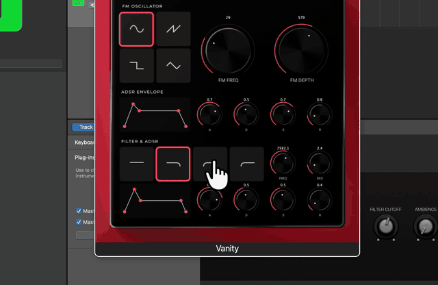

# Vanity

A monophonic subtractive synthesizer written in C++ with the [JUCE](https://juce.com) framework.

## Features

- **Oscillator** with sine, saw, square and triangle waveforms
- **Amplitude envelope** (ADSR)
- **State-variable filter** with low-pass, band-pass and high-pass modes (or bypass), plus cutoff and resonance controls
- **Second ADSR envelope** that modulates the filter cutoff
- Custom-styled JUCE interface with separate components for the oscillator, envelope and filter sections
- Parameters are managed with JUCE's `AudioProcessorValueTreeState`

## Project layout

| File | Role |
|---|---|
| `PluginProcessor.*` | Audio processing and parameter definitions |
| `PluginEditor.*` | Main editor window |
| `SynthVoice.*`, `SynthSound.h` | Voice rendering: oscillator, amplitude envelope, filter, gain |
| `OSCData.*` | Oscillator and waveform selection |
| `ADSRData.*`, `FilterData.*` | Envelope and filter wrappers |
| `*Component.*`, `*Selector.*`, `StyleSheet.*` | User interface components and styling |

## Build

1. Install [JUCE](https://juce.com) and open `Synth_00.jucer` in the Projucer.
2. Export the project for your IDE (Xcode, Visual Studio or a Linux makefile) and build.

## Status and limitations

A personal project for learning audio DSP and JUCE. It has a single voice (no polyphony yet), and parameter values are not saved or restored between sessions.
